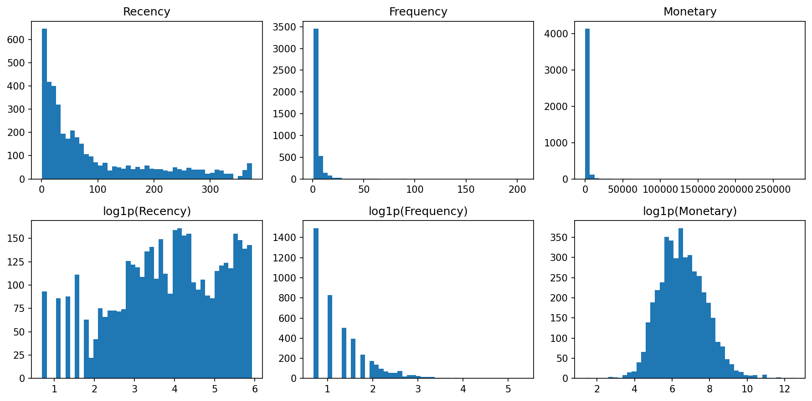
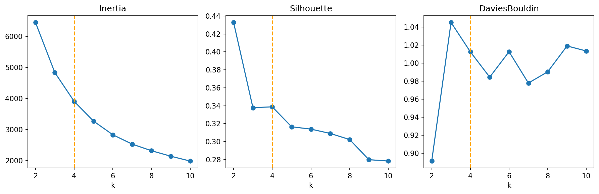
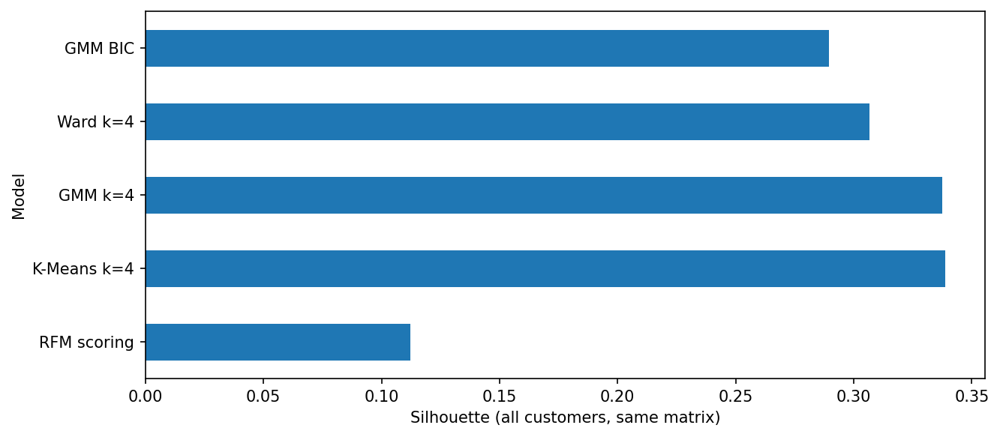
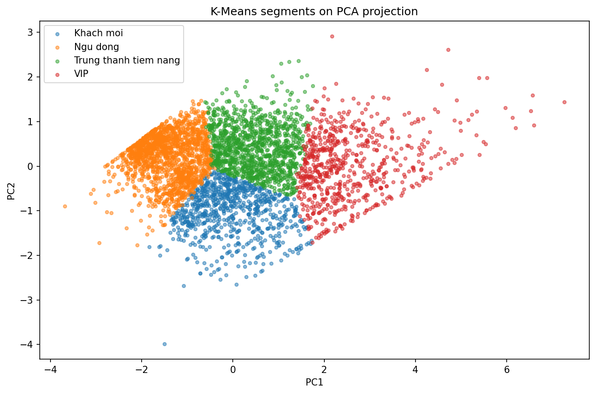
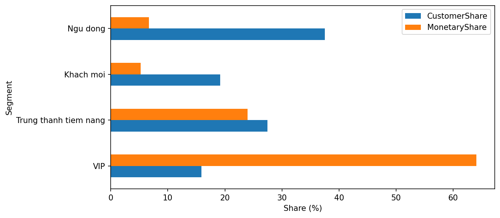

# Phân khúc khách hàng Online Retail

Báo cáo được tạo tự động bằng `python src/pipeline.py`. Nguồn số liệu hiện hành
là `outputs/tables/` và `outputs/run_summary.json`; các bản PR lưu trong `results/`
và notebook snapshot chỉ dùng tham khảo lịch sử.

## 1. Bài toán và phạm vi

Phân nhóm khách hàng theo hành vi mua trong kỳ để đề xuất chăm sóc và marketing.
Đây là học không giám sát: không có nhãn khách hàng chuẩn để tính accuracy.
Kết quả mô tả hành vi lịch sử, chưa chứng minh hiệu quả của chiến dịch.

Dữ liệu gốc: [UCI Online Retail](https://archive.ics.uci.edu/dataset/352/online+retail),
tệp `Online Retail.xlsx` đi kèm repo. Kỳ quan sát thực tế: **2010-12-01 08:26:00**
đến **2011-12-09 12:50:00**. Đơn vị tiền của dữ liệu là bảng Anh (GBP).

## 2. Làm sạch và định nghĩa đặc trưng

| Chỉ tiêu | Số lượng |
| --- | --- |
| Raw transaction rows | 541909 |
| Clean purchase rows | 397884 |
| Duplicate purchase rows removed | 5192 |
| Product purchase rows | 391150 |
| Cancelled product rows | 8506 |
| Gross RFM customers | 4338 |
| Customers before positive-net filter | 4334 |
| Final customers | 4320 |

Loại dòng thiếu CustomerID, hóa đơn hủy khỏi bảng mua, số lượng/giá không dương,
dòng trùng và mã ngoài quy tắc sản phẩm `^\d{5}`. Quy tắc mã hàng là giả định
làm sạch của project, cần rà soát lại khi áp dụng cho nguồn dữ liệu khác.
Giao dịch hoàn/hủy lấy từ dữ liệu gốc: mã hóa đơn C, số lượng âm, giá dương,
cùng quy tắc sản phẩm và loại trùng.

- **Recency:** số ngày từ lần mua gần nhất đến thời điểm mua hợp lệ cuối + 1 ngày.
- **Frequency:** số hóa đơn mua hợp lệ khác nhau; chưa giảm khi hoàn một phần đơn.
- **Monetary:** tổng giá trị mua hợp lệ trừ giá trị hoàn/hủy ghi nhận trong kỳ,
  làm tròn hai chữ số; giữ khách có giá trị cuối dương.
- Tenure, AvgOrderValue, UniqueProducts, TotalItems, ReturnRate và Country dùng
  mô tả nhóm, không đưa vào ma trận phân cụm chính.

Monetary là **chi tiêu ròng ghi nhận trong kỳ**, không phải lợi nhuận. Không có
đối soát từng dòng hoàn với hóa đơn mua; hoàn của đơn trước kỳ vẫn có thể bị trừ.
Recency/Frequency mô tả hoạt động mua, không khẳng định khách đã giữ lại sản phẩm.

## 3. Khám phá và tiền xử lý

RFM có phân phối lệch; dùng `log1p` rồi `StandardScaler` để cân bằng thang đo.
Cả mô hình và metrics chính dùng **cùng 4,320 khách, cùng thứ tự ID,
cùng ba đặc trưng và không chặn ngoại lệ**. Tất cả dữ liệu được dùng để mô tả
phân khúc hiện tại; đây không phải đánh giá khả năng dự báo tương lai.

RFM scoring là baseline quy tắc. Điểm theo ngưỡng phân vị thực nghiệm, các giá trị
bằng nhau nhận cùng điểm; vì thế số khách mỗi mức điểm không nhất thiết bằng nhau.

## 4. Mô hình và cách chọn

K-Means khảo sát k=2–10, xét inertia, silhouette, Davies–Bouldin, độ ổn định
và khả năng diễn giải. k=4 là cấu hình kinh doanh được chọn để có bốn nhóm hành động;
không khẳng định k=4 tối ưu tuyệt đối trên mọi chỉ số.

GMM k=4 dùng full covariance, reg_covar=0.1, 30 lần khởi tạo. Ward dùng k=4.
GMM BIC khảo sát 2–10 thành phần và bốn dạng covariance; chỉ nhận ứng viên hội tụ,
có nhóm nhỏ nhất ít nhất max(20, 1% số khách). BIC dùng chọn mô hình mật độ GMM,
không so trực tiếp với inertia K-Means. Ma trận, cấu hình và mô hình đều được lưu.

## 5. Kết quả so sánh

Silhouette, Davies–Bouldin và Calinski–Harabasz dưới đây tính trên **toàn bộ**
ma trận chung. Silhouette càng cao, DB càng thấp, CH càng cao càng thuận lợi
theo tiêu chí tương ứng; các chỉ số này không đo thành công kinh doanh.

| Model | Components | Silhouette | DaviesBouldin | CalinskiHarabasz | SmallestSegment | LargestSegment | SmallestShare | LargestShare |
| --- | --- | --- | --- | --- | --- | --- | --- | --- |
| RFM scoring | 10 | 0.1121 | 1.4531 | 1,267.0048 | 36 | 1337 | 0.0083 | 0.3095 |
| K-Means k=4 | 4 | 0.3388 | 1.0124 | 3,330.8602 | 685 | 1622 | 0.1586 | 0.3755 |
| GMM k=4 | 4 | 0.3376 | 0.9761 | 3,156.3589 | 554 | 1858 | 0.1282 | 0.4301 |
| Ward k=4 | 4 | 0.3066 | 1.0394 | 2,780.2228 | 210 | 2195 | 0.0486 | 0.5081 |
| GMM BIC | 8 | 0.2894 | 1.0140 | 2,679.3941 | 69 | 986 | 0.0160 | 0.2282 |

Độ ổn định qua năm seed (0–4), tính ARI cho mọi cặp, không phụ thuộc hoán vị nhãn:

| Model | min | median |
| --- | --- | --- |
| GMM k=4 | 0.9190 | 0.9441 |
| K-Means k=4 | 0.9861 | 1.0000 |

Độ nhạy GMM BIC theo regularization trên cùng đầu vào không chặn:

| reg_covar | n_components | covariance_type | bic | smallest_segment | eligible_candidates |
| --- | --- | --- | --- | --- | --- |
| 0.0300 | 10 | diag | 27,456.3181 | 66 | 33 |
| 0.0500 | 8 | full | 28,701.8381 | 80 | 35 |
| 0.1000 | 8 | full | 29,532.8991 | 65 | 28 |
| 0.2000 | 4 | full | 30,723.7462 | 474 | 15 |

Với cấu hình BIC chọn và 10 lần khởi tạo, năm seed cho ARI cặp thấp nhất
**0.6461**, trung vị
**0.7035**. Đây là kiểm tra khởi tạo riêng;
mô hình GMM BIC cuối dùng 30 lần khởi tạo. Số nhóm BIC chọn nhạy với regularization,
vì vậy không tự động dùng số nhóm này làm phân khúc kinh doanh cuối.

K-Means k=4 được giữ làm mô hình chính nhờ sự cân bằng giữa chất lượng phân cụm,
kích thước nhóm, độ ổn định và khả năng diễn giải. GMM k=4 là đối chiếu trực tiếp;
GMM BIC là phân tích khám phá ở số nhóm khác. RFM scoring có số nhóm khác nên
metrics chỉ cung cấp ngữ cảnh, không xem là cuộc so sánh cùng độ chi tiết.

## 6. Chân dung và hành động

| Segment | CustomerCount | RecencyMedian | FrequencyMedian | MonetaryMedian | TenureMedian | CustomerShare | MonetaryShare |
| --- | --- | --- | --- | --- | --- | --- | --- |
| VIP | 685 | 8.0000 | 10.0000 | 3,622.9500 | 358.0000 | 0.1586 | 0.6406 |
| Trung thanh tiem nang | 1185 | 52.0000 | 4.0000 | 1,315.7200 | 281.0000 | 0.2743 | 0.2397 |
| Khach moi | 828 | 17.0000 | 2.0000 | 448.6050 | 65.0000 | 0.1917 | 0.0527 |
| Ngu dong | 1622 | 177.0000 | 1.0000 | 290.2950 | 219.5000 | 0.3755 | 0.0670 |

Tên VIP, Ngủ đông, Khách mới và Trung thành tiềm năng là nhãn mô tả tương đối
trong tập dữ liệu. "Khách mới" là nhóm có tenure ngắn hơn nhóm trung gian còn lại,
không đảm bảo từng khách đều mới mua lần đầu. Các tên trong CSV viết không dấu.

| Segment | CustomerCount | ActionHypothesis | KPI |
| --- | --- | --- | --- |
| VIP | 685 | Giu chan, quyen loi thanh vien, gioi thieu khach | Repeat purchase rate; retention; contribution margin |
| Trung thanh tiem nang | 1185 | Nhac mua lai, cross-sell, uu dai theo nguong | Repeat purchase rate; net spend; margin |
| Khach moi | 828 | Onboarding, thu nghiem uu dai lan mua thu hai | Second purchase within 60 days |
| Ngu dong | 1622 | Thu nghiem win-back chi phi thap | Reactivation rate; cost per reactivated customer |

Các hành động là giả thuyết. Cần thử nghiệm có nhóm đối chứng, kiểm soát chi phí,
biên lợi nhuận và đo KPI trước khi triển khai diện rộng. GMM_Confidence là xác suất
hậu nghiệm theo GMM, không phải độ chắc chắn của nhãn K-Means hoặc nhãn marketing.

## 7. Giới hạn và bước tiếp theo

- Dữ liệu lịch sử của một nhà bán lẻ; không suy rộng trực tiếp cho doanh nghiệp khác.
- Nhiều khách Frequency=1; cấu trúc rời rạc và ngoại lệ ảnh hưởng GMM.
- Tên nhóm và k=4 có yếu tố phán đoán; ranh giới nhóm không phải sự thật cố định.
- Kiểm tra seed đánh giá khởi tạo, chưa thay thế bootstrap và kiểm tra theo thời gian.
- Để triển khai: đánh giá trên kỳ sau, theo dõi drift và thay đổi nhóm; RFM cho khách
  mới phải dùng cùng cửa sổ thời gian và định nghĩa nghiệp vụ trước khi suy luận.

`outputs/tables/preprocessing_sensitivity.csv` kiểm tra riêng tác động chặn phân vị 99%
đối với K-Means k=4. Các kết quả GMM chặn 99% từ PR cũ được giữ riêng trong `results/`;
không trộn các metrics khác ma trận vào bảng so sánh chính.

| Preprocessing | ARI_vs_uncapped | Components | Silhouette | DaviesBouldin | CalinskiHarabasz | SmallestSegment | LargestSegment | SmallestShare | LargestShare |
| --- | --- | --- | --- | --- | --- | --- | --- | --- | --- |
| No cap | 1.0000 | 4 | 0.3388 | 1.0124 | 3,330.8602 | 685 | 1622 | 0.1586 | 0.3755 |
| 99% upper cap | 0.9132 | 4 | 0.3378 | 1.0129 | 3,480.9444 | 739 | 1550 | 0.1711 | 0.3588 |

## 8. Tái lập và xác minh

Chạy `python src/pipeline.py`, sau đó `python src/verify_project.py`.
Fingerprint CSV chuẩn hóa LF/CRLF, vẫn phát hiện thay đổi nội dung.
`outputs/run_summary.json` ghi phiên bản thư viện; `requirements-lock.txt` khóa
môi trường đã kiểm tra. Model lưu bằng joblib chỉ được nạp từ nguồn tin cậy.

Nguồn dữ liệu: Chen, D. (2015). *Online Retail* [Dataset]. UCI Machine Learning
Repository. [DOI](https://doi.org/10.24432/C5BW33),
[CC BY 4.0](https://creativecommons.org/licenses/by/4.0/). Các bảng đặc trưng và
kết quả của project là bản biến đổi từ dữ liệu gốc.
